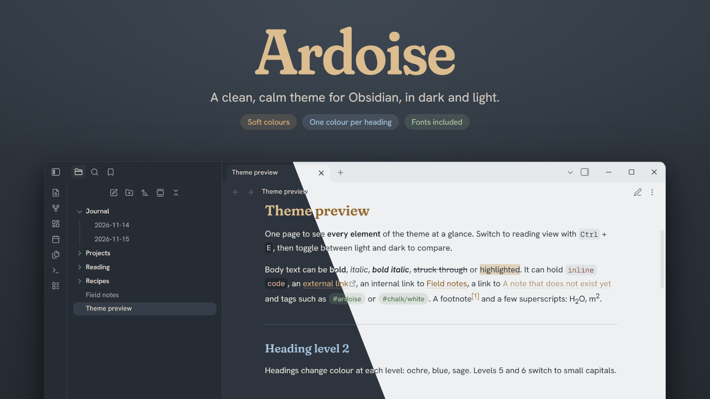

# Ardoise

A clean, calm theme in dark and light.



*Ardoise* is French for slate. In dark mode, chalk-coloured text sits on a blue-grey slate. In light mode, slate-coloured text sits on a pale blue-grey sheet. Ochre is the accent, with touches of blue, sage and rose.

<a href="https://www.buymeacoffee.com/eddynicolle"></a>

## Features

- Dark and light modes: easy on the eyes, with high contrast for body text (about 9:1 or more)
- One colour per heading level: ochre, blue, sage
- Pill-shaped tags, quiet tabs and status bar, thin scrollbars
- Fonts included:
  - Hanken Grotesk for text and interface
  - Fraunces for headings
  - Geist Mono for code

Ardoise aims for WCAG AA contrast. See [CONTRAST.md](CONTRAST.md) for the details.

## Customisation

Colours are CSS variables at the top of `theme.css`, with one block for each mode: `--bg-page` (note background), `--text` (body text), `--ochre` (accent), `--blue`, `--sage` and `--rose`. You can override them with a CSS snippet:

```css
.theme-dark {
  --ochre: #e0b070;
}
```

To use your body font for headings too:

```css
body {
  --heading-font: var(--font-text);
}
```

Fonts set in **Settings → Appearance → Font** take precedence over the theme's fonts.

## Credits

The bundled fonts are licensed under the SIL Open Font License 1.1. Their license files are in the `fonts` folder.

- [Hanken Grotesk](https://github.com/marcologous/hanken-grotesk), © The Hanken Grotesk Project Authors
- [Fraunces](https://github.com/undercasetype/Fraunces), © The Fraunces Project Authors
- [Geist Mono](https://github.com/vercel/geist-font), © The Geist Project Authors

The alternate checkbox icons come from [Minimal](https://github.com/kepano/obsidian-minimal) by Steph Ango, released under the MIT License.

## License

The theme is released under the [MIT License](LICENSE). The bundled fonts keep their own license (OFL 1.1).
